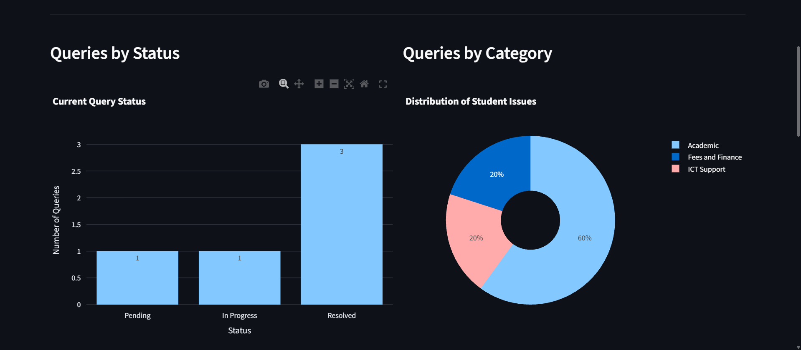

# Student Query Analytics System

A Python-based web application for recording, managing, and analysing student queries using Streamlit, SQLite, Pandas, and Plotly.

## Overview

The Student Query Analytics System helps organise student queries and provides a dashboard for understanding query patterns, departmental workload, priorities, and resolution progress.

## Features

- Submit student queries through a web form.
- Validate submissions and detect recent duplicate queries.
- Store records in an SQLite database.
- Update query statuses: Pending, In Progress, and Resolved.
- Filter and search submitted queries.
- Visualise query status, categories, departments, and priorities.
- Analyse submission trends over time.
- Calculate resolution rates and resolution durations.

## Technologies Used

- Python
- Streamlit
- SQLite
- Pandas
- Plotly
- Git and GitHub

## Getting Started

### Prerequisites

- Python 3 installed
- Git installed

### Installation

1. Clone this repository:

   ```bash
   git clone https://github.com/Jwakoli/student-query-analytics
   ```

2. Navigate into the project directory:

   ```bash
   cd student-query-analytics
   ```

3. Create a virtual environment:

   ```bash
   python -m venv .venv
   ```

4. Activate the virtual environment on Windows Command Prompt:

   ```bat
   .venv\Scripts\activate.bat
   ```

5. Install the required packages:

   ```bash
   pip install -r requirements.txt
   ```

6. Initialise the database:

   ```bash
   python database.py
   ```

7. Launch the application:

   ```bash
   streamlit run app.py
   ```

8. Open the local URL displayed in the terminal.

## Project Structure

```text
student-query-analytics/
├── app.py
├── database.py
├── requirements.txt
├── README.md
├── .gitignore
└── data/
```

## Future Improvements

- Add user authentication and role-based access.
- Add exportable reports.
- Improve analytics with additional performance indicators.
- Add automated tests.
- Deploy the application online.

## Author

Jesse Wanjala Wakoli

Computer Science student interested in data analytics and technology.

## 📸 Application Screenshots

### Analytics Dashboard



